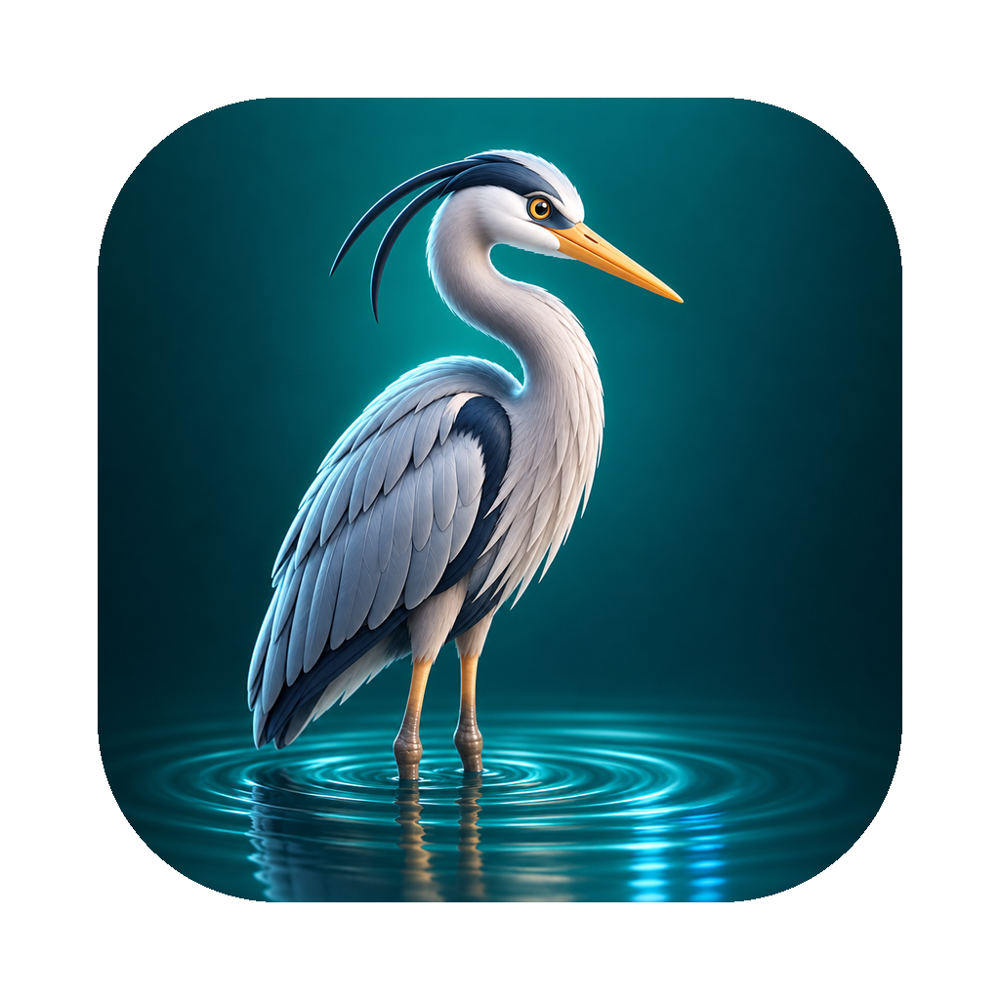

<p align="center">
  
</p>

<h1 align="center">Heron</h1>

<p align="center">
  A native PHP and Laravel scratchpad for macOS.<br>
  Write a few lines, press ⌘R, see the result.
</p>

---

Heron runs PHP snippets with the PHP already on your Mac (Laravel Herd or Homebrew). Pick a project and the snippet runs inside it: Laravel is booted, so models, config and the database are right there. It's built with SwiftUI and runs only on macOS.

> **Status:** early development.

## Features

| | Feature | Status |
|---|---|---|
| ▶️ | Run a snippet with ⌘R, stop it with ⌘. | Done |
| 🧱 | Run inside a project; Laravel is booted automatically | Done |
| 🌳 | Result cards for every `dump()` and the last statement, printed like a PHP debugger; Eloquent models show attributes and relations | Done |
| 🔴 | Errors and warnings shown at their line in the editor; a mark in the gutter on every line that ran | Done |
| 🧹 | Tidy code on run: indentation, spacing, one statement per line | Done |
| ⚙️ | Editor settings: font, size, tabs or spaces, indent width, line wrap | Done |
| 🌍 | English and Turkish | Done |
| 🗂 | Tabs, history (⌘Y), saved snippets (⌘B, shareable per project), open-anything palette (⌘P), welcome tab | Done |
| 📊 | Table view for lists of rows, with search and CSV export; database queries on demand | Done |
| 🎨 | Five themes, dark by default | Done |
| ✨ | Completion while typing: classes (with their `use` line), `->` and `::` members by reflection (columns, relations, scopes, facades), chains like `User::where()->first()->`, functions and variables; a chosen callable brings its required parameters as placeholders (Tab moves on); brackets and quotes pair up | Done |
| 🔐 | Run on a server over SSH (⌘⇧K): saved connections in groups, password or key sign-in, trust-on-first-use host keys; the snippet runs inside the remote project with its PHP | Done |
| 🐳 | Run in a Docker container | Planned |
| 📜 | Log viewer (⌘L): storage/logs files of the project or the connected server, level filter, search, pages, live reload, full record with stack trace | Done |

## Get Heron

- Download the latest DMG from [Releases](https://github.com/Voxyfy/heron/releases/latest). It's signed and notarized; updates arrive in the app (Sparkle).
- 14-day free trial, then **$10 a year** for two Macs, sold through Lemon Squeezy. The key goes into Heron ▸ License… (or Settings ▸ License).
- Site: [voxyfy.github.io/heron](https://voxyfy.github.io/heron) · [Support](https://voxyfy.github.io/heron/support.html) · [Privacy](https://voxyfy.github.io/heron/privacy.html)

## Requirements

- macOS 15 or later
- PHP 8.1 or later, from [Laravel Herd](https://herd.laravel.com) or Homebrew (`brew install php`)

## Building

Heron uses [XcodeGen](https://github.com/yonaskolb/XcodeGen); the Xcode project isn't checked in.

```sh
brew install xcodegen
xcodegen generate
open Heron.xcodeproj
```

`scripts/run-dev.sh` builds and launches a signed copy. Set `HERON_SIGN_IDENTITY` to your certificate's name or hash.

## Testing

```sh
xcodebuild -scheme Heron test -test-timeouts-enabled YES -default-test-execution-time-allowance 60
```

The tests use the PHP on your Mac and are skipped when there is none. To also check booting a Laravel app, point `TEST_RUNNER_HERON_LARAVEL_PROJECT` at one with `vendor/` installed.

The SSH round trip runs against a local test server on port 2224 and is skipped when none is listening. To start one:

```sh
docker run -d --name heron-sshd -p 2224:2222 -e PUID=1000 -e PGID=1000 -e USER_NAME=heron \
  -e PASSWORD_ACCESS=true -e USER_PASSWORD=heron-test lscr.io/linuxserver/openssh-server:latest
docker exec heron-sshd sh -c 'apk add --no-cache php83-cli php83-tokenizer php83-mbstring php83-ctype && ln -sf /usr/bin/php83 /usr/bin/php \
  && mkdir -p /config/app && echo "<?php return [\"name\"=>\"Heron remote\"];" > /config/app/config.php && chown -R 1000:1000 /config/app'
```

## Releasing

`scripts/release.sh` archives a Release build, signs it with Developer ID, builds a DMG, notarizes and staples it, signs the update with Sparkle's EdDSA key and adds the `<item>` to `docs/appcast.xml`. One-time setup is described at the top of the script (notarytool credentials, Sparkle keys, `SPARKLE_PUBLIC_ED_KEY` in project.yml, Lemon Squeezy IDs in `Heron/License/LicenseConfig.swift`). Afterwards: edit `docs/releases/<version>.html`, commit `docs/`, push, and create the GitHub release with the DMG attached.

## Translations

After adding strings, build once, then:

```sh
xcrun xcstringstool sync Heron/Resources/Localizable.xcstrings --stringsdata <DerivedData>/…/*.stringsdata
python3 scripts/apply_translations.py   # lists keys still missing Turkish
```

## How it works

```
Heron/
  App/       App entry, menus (Code ▸ Run ⌘R, Stop ⌘.)
  Editor/    NSTextView editor: highlighting, indentation, line notes; editor settings
  Runner/    PHPRunner (one php process per run), runner.php, format.php, complete.php (reflection for the completion list)
  Remote/    RemoteConnection + ConnectionStore (connections.json, secrets in Keychain), RemoteRunner (Citadel SSH), host keys
  Views/     Main window, result panel, connection manager, workspace state
```

Each run starts a fresh `php` process with `runner.php`. It boots the project, runs the snippet with `eval`, and writes the result (the last expression's value, the error, warnings with line numbers, time and memory) to a JSON file. Echoed output stays on stdout. If the last statement is an expression, Heron adds `return`, so `User::count()` on the last line shows its value.

`format.php` tidies the snippet using PHP's own tokenizer, so strings and comments are never touched.

On a server, one SSH command does the whole run: `runner.php` and the snippet travel inside it as base64 into a temporary folder, `php` runs from the project folder, the result JSON is printed after a marker, and the folder is removed. Nothing in the remote project changes. Connections are saved in `~/Library/Application Support/Heron/connections.json`; passwords, keys and passphrases only in Keychain.

## License

Source-available, all rights reserved. See [LICENSE](LICENSE).

---

© 2026 Voxyfy
